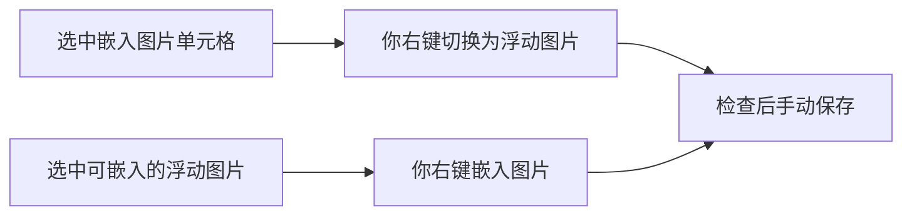

# WPS 图片选择工具

[](https://github.com/hcycyxx/wps-picture-tools/releases/latest)

[](LICENSE)

**一键选好图片，由你右键完成嵌入或转浮动。** WPS在图片嵌入单元格的情况下发给别人，别的电脑打开图片会不显示，变成一串函数。所以要先嵌入图片后再发送。
本插件方便一键全选所有图片并嵌入单元格。全选图片时会避开有内容的单元格，这样嵌入图片就不会覆盖原有文字内容。

## 下载与安装

👉 **[下载安装 EXE](https://github.com/hcycyxx/wps-picture-tools/releases/download/v1.5.0/WpsPictureTools-Setup-v1.5.0.exe)** · [全部附件](https://github.com/hcycyxx/wps-picture-tools/releases/tag/v1.5.0)

1. 先打开 **Windows WPS 表格**，需要支持 VBA 和加载项。
2. 运行安装 EXE，点击“安装到 WPS”。不需要另外安装 Python。
3. 顶部“图片工具”出现两个选择按钮和三个金额按钮。检查完表格后自行保存。

安装器不修改 WPS 的宏安全设置，不自动下载或安装 VBA 环境。新电脑仍需自行确认 WPS 支持情况。

## 操作流程（示意）

以下为功能流程图，不是真实界面截图；新版实际按钮已由用户确认选区正确。



| 按钮 | 选中什么 | 接下来由你操作 |
|---|---|---|
| 选中嵌入图片单元格 | 当前表中 DISPIMG 图片单元格及合并区域 | 在选区右键“切换为浮动图片” |
| 选中可嵌入的浮动图片 | 当前表中目标为空的独立浮动图片 | 在选中的图片上右键嵌入 |

成功和跳过的数量显示在 WPS 底部状态栏。三个金额按钮的流程为：选金额 → 点按钮 → 复制结果 → 自行粘贴，不覆盖原金额。

## 选择规则和限制

- 浮动图按左上角所在单元格判断，合并区域检查左上角单元格。目标有文字、数字、公式（即使显示空白）或错误值都跳过。
- 多张图指向同一个空单元格时全部跳过，避免嵌入覆盖。不拆分组合对象，不选图表、图标等非图片对象。
- 当前工作表分别操作，不能跨表一次右键转换。没有合格图片时取消旧图片选区并提示。
- 嵌入图选择不依赖图片尺寸，也不要求先取消隐藏。隐藏图片和多区域选区的实际右键行为仍由 WPS 决定。
- 本工具不重新编码或插入图片，不承诺 WPS 原生右键转换的速度和尺寸。旧自动转换方案不在此公开包中。
- 使用时不上传客户表格或图片。客户文件、样例、日志及恢复快照不包含在仓库或附件中。

## 更新、停用和手动安装

安装目录为 `%LOCALAPPDATA%\WpsPictureFloat\1.5.0`。更新只停用同一目录体系中的本工具旧加载项，保留旧文件，不改其他插件。安装器的“停用图片加载项”仅取消启用，不删除文件。

同版本目标文件若内容不同，安装器停止而不覆盖；发现已启用更高版本时也停止。其他位置的手动安装副本不由安装器管理，应自行检查重复按钮。

不使用 EXE 时，可解压 Release 的 XLAM 包，在 WPS“开发工具 → 加载项”里浏览并启用 `KynkoPictureTools_1_5_0.xlam`。按钮不出现时，先检查加载项是否启用，以及当前 WPS 是否具备 VBA 支持。

## 源码与构建

需要 Windows、Python 3.12、支持 VBA 的 WPS。安装器构建使用 PyInstaller，WPS 负责 VBA 编译。

```powershell
python -m pip install -r requirements-build.txt
# 保持 WPS 打开，独立实例编译，不操作正在编辑的客户表格
python scripts/build_addin.py
python scripts/build_setup.py
# 只校验安装包，不安装或修改 WPS
python src/setup.py --info
```

产物在 `dist/1.5.0`，已存在的产物不覆盖。发布新版本需同步 `project.json` 和文档，保留旧版本。`src/PictureSelection.bas` 是图片选择逻辑；`src/AmountWords.bas` 是金额复制逻辑；`src/ribbon.xml` 定义按钮。源码 ZIP 包含全部必要源码和中文文档，编译后的安装程序在独立 EXE 附件中。

安装脚本支持 `--info`、`--status`、`--install`、`--uninstall`；窗口版 EXE 使用 `--report 新文件路径.json` 可输出诊断结果，已有报告不覆盖。

## Skill

下载 Release 中的 `wps-picture-tools-skill-v1.2.0.zip`，将其中 `wps-picture-tools` 目录放入 Codex 的 skills 目录。技能包含选择流程、维护规则和可移植源码快照；不包含本机绝对路径或客户文件。技能用于辅助维护，WPS 的实际功能由加载项提供。

## 验证范围

2026-11-13，原用户已确认两个选择按钮选区正确、目标有内容的图片已排除。保留的五按钮加载项已安装使用。发布的安装 EXE 已构建并执行包内容校验；未在另一台电脑完整安装验收，也没有承诺 260 张高清图的原生转换速度。

尚无新版真实界面截图，首页使用明确标注的操作示意图。[更新记录](CHANGELOG.md)。

<!-- jack-white-rice-support:start -->
## 请大肥鱼吃大白饭 🍚

如果这个项目帮到了你，欢迎请大肥鱼吃一碗大白饭。自愿投喂，量力而行，感谢支持！

<p>
  <a href="assets/support/alipay-jack-v1.jpg"></a>
  <a href="assets/support/rice-meme-v1.png"></a>
</p>
<!-- jack-white-rice-support:end -->

## 许可证

[MIT](LICENSE)。金额模块与安装器沿用作者的 [wps-amount-words](https://github.com/hcycyxx/wps-amount-words) 项目代码，保留 MIT 许可。
